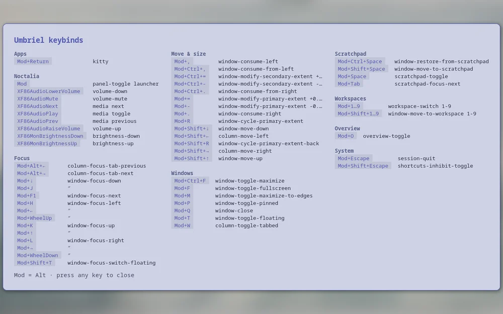

# Getting started



## Starting Umbriel

Installed display-manager sessions start Umbriel through `start-umbriel`. Select Umbriel from your display manager, or start it from a TTY:

```sh
start-umbriel
```

The launcher loads the login profile for supported shells such as bash, zsh, and fish. Environment variables from that profile, including `PATH`, are available to Umbriel and applications started in the session. Interactive shell files such as `~/.zshrc` are not loaded. In a systemd-managed session, the launcher imports the login environment into the user manager before starting Umbriel. Login-profile values take precedence over values with the same names from `environment.d`; variables found only in the user manager remain available. The direct fallback inherits the same login environment without importing it.

In a systemd-managed native session, Umbriel places startup, autostart, event, and `spawn` commands in scopes bound to the compositor service, so they are cleaned up when the session ends. This requires systemd 254 or newer.

The compositor service queues the graphical session targets at startup and reports readiness only after its display and IPC sockets are available and its session environment has been published to systemd and D-Bus. Services ordered after `graphical-session.target`, including desktop portals, wait for that readiness notification. Configured startup commands also wait for the environment import to finish.

Run `umbriel` directly only for a nested development session or an explicitly unmanaged launch.

### dinit sessions

With a running dinit 0.23 or newer user manager, `start-umbriel` can start the packaged `umbriel` and `umbriel-session` services. The user manager needs a `dbus` service. An explicitly configured, reachable `DINIT_SOCKET_PATH` selects dinit; otherwise the launcher prefers a reachable systemd user manager and then tries dinit. If neither is available, it launches Umbriel directly.

The launcher imports the login environment, waits for the compositor's display and IPC sockets and environment publication, and then starts the session services. Configured `[environment]` values also reach dinit services. Logout and launcher interruption stop the compositor and its dependent services, then clear graphical variables from dinit and D-Bus activation. A compositor crash also stops dependent services and causes the launcher to report failure.

Enable services for the session with:

```sh
mkdir -p ~/.config/dinit.d/umbriel-session.d
dinitctl --user enable --from umbriel-session my-session-service
```

Each session service must include `depends-on: umbriel` so it waits for compositor readiness and stops before the compositor on logout. Add this dependency in a user service definition or the override mechanism supplied by your distribution. The session target reads enabled services from `$HOME/.config/dinit.d/umbriel-session.d`.

An environment import failure stops startup. This includes entries too large for dinit's control protocol, such as large compiler variables in a development shell. Start from the normal login environment or launch `umbriel` directly when no manager environment import is wanted.

```sh
dinitctl --user status umbriel
dinitctl --user catlog umbriel
```

Explicit arguments to `start-umbriel`, including `-c` and `-s`, use the direct launch path on dinit. To supervise a compositor with custom arguments, adjust the `command` in its dinit service definition. Nested launches also run directly.

Applications launched with autostart or `spawn` remain children in the compositor's process group. They receive the group's stop signal during a managed stop, but have no separate application scopes. Applications that detach, ignore that signal, or survive a compositor crash can outlive the session. Run background services under dinit with `depends-on: umbriel` when their lifetime must follow the session.

## First keys

The [cheatsheet](keybinds.md#cheatsheet) lists every active keybind; press any key to close it. With the packaged configuration, Mod+Return opens kitty, Mod alone toggles the Noctalia launcher, Mod+Q closes the focused window, and Mod+O opens the [overview](workspaces-overview.md). `Mod` is Super, or Alt when Umbriel runs nested. The full list is under [Default keybinds](keybinds.md#default-keybinds).

## Starting configuration

The packaged starting configuration is [`examples/config.toml`](https://github.com/noctalia-dev/umbriel/blob/main/examples/config.toml). Copy it before making local changes:

```sh
mkdir -p ~/.config/umbriel
cp /usr/share/umbriel/config.toml ~/.config/umbriel/config.toml
```

A manual installation under `/usr/local` places it at `/usr/local/share/umbriel/config.toml`. Nix users should prefer `programs.umbriel.settings` in Home Manager or hjem.

Umbriel applies most changes when you save the file. Errors and warnings appear on screen, and `umbriel config validate` checks a configuration without a running session. See [Configuration](configuration.md) for file locations, includes, and the general settings.

## Screen sharing

Screen sharing in Discord, browsers, and other portal-aware applications needs [`xdg-desktop-portal-umbriel`](https://github.com/noctalia-dev/xdg-desktop-portal-umbriel). If the picker does not appear, see [Troubleshooting](troubleshooting.md#screen-sharing-picker-missing-after-login).

On rotated or flipped outputs, the shared cursor may appear offset because of a wlroots 0.20.2 cursor metadata issue.

## Next steps

1. Pick a [layout](layout.md) and a [workspace model](workspaces.md).
2. Configure your [outputs](outputs.md), [input devices](input.md), and [keybinds](keybinds.md).
3. Use [window rules](window-rules.md) for application-specific behavior.
