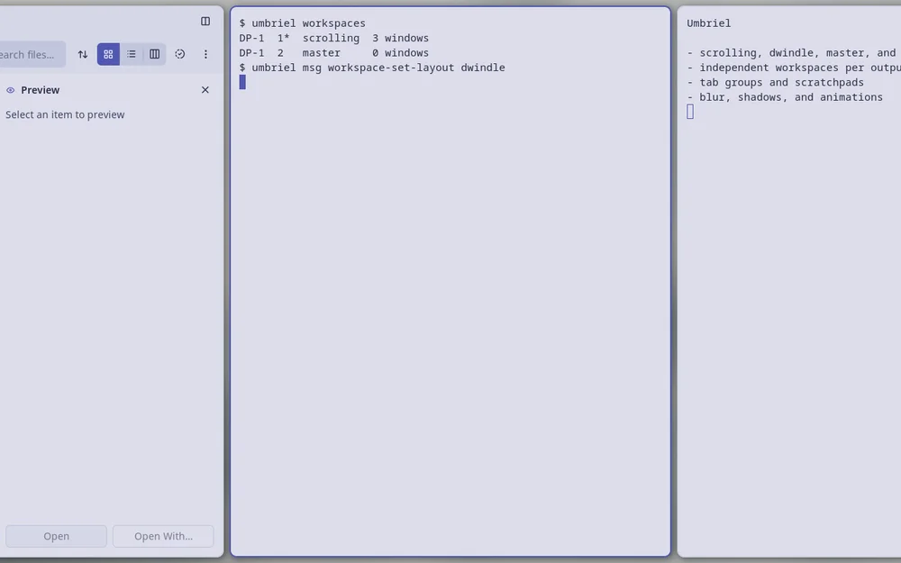

# Umbriel

Umbriel is a Wayland compositor. It arranges your windows in scrolling, dwindle, master, or stacking layouts, gives every monitor its own workspaces, and draws blur, shadows, and animations without getting in the way. It works on its own or with [Noctalia](https://docs.noctalia.dev/noctalia/), a desktop shell designed to integrate with Umbriel.

## What it does

- Lays out each workspace as a scrolling strip of columns, a dwindle or master tiling, or freely stacked windows.
- Keeps independent workspaces on every output, with an overview to see and rearrange them all.
- Groups windows into tabs, and hides others in scratchpads you call up with one key.
- Applies window and layer rules to place, size, and style specific applications.
- Draws blur, shadows, rounded corners, animations, and custom GLSL effects.
- Supports HDR, variable refresh rate, and tearing for games, where hardware and clients allow.
- Runs X11 applications through Xwayland, and answers scripts and panels over local IPC.

## Where to start

1. [Install Umbriel](installation.md) from a package, or [build it from source](building.md).
2. Follow [Getting started](getting-started.md) to log in, learn the first keys, and copy the starting configuration.
3. Pick a [layout](layout.md), then configure your [outputs](outputs.md), [input devices](input.md), and [keybinds](keybinds.md).

> [!NOTE]
> Umbriel is young and actively evolving. Configuration and behavior may change between releases, and you may encounter rough edges.

## Get help

Report problems on the [issue tracker](https://github.com/noctalia-dev/umbriel/issues) or ask on [Discord](https://discord.noctalia.dev); [Troubleshooting](troubleshooting.md) lists what to include. Feature requests are considered against the project's [scope statement](https://github.com/noctalia-dev/umbriel/blob/main/SCOPE.md). For development, see [Contributing](https://github.com/noctalia-dev/umbriel/blob/main/CONTRIBUTING.md) and [Packaging](https://github.com/noctalia-dev/umbriel/blob/main/PACKAGING.md).
