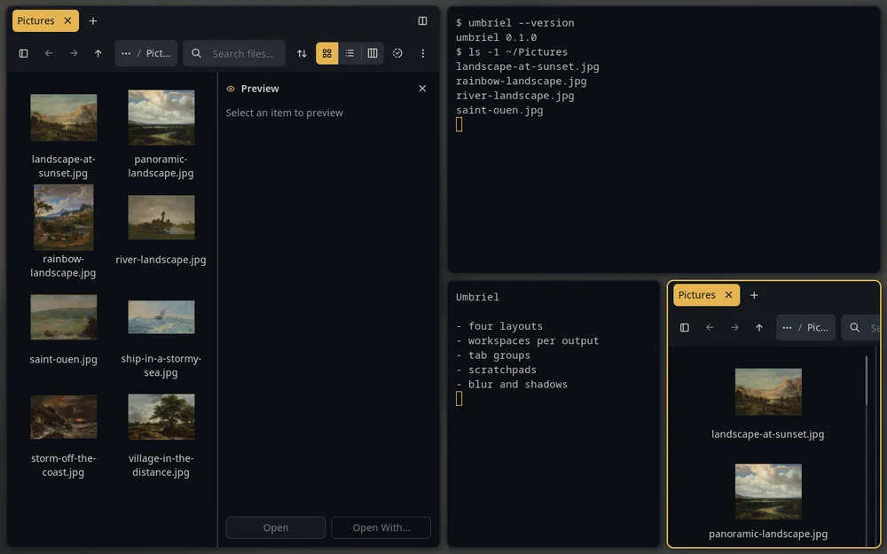

# Dwindle layout



Dwindle recursively splits tiles into independently sized regions.

## Settings

```toml
[layout.dwindle]
preserve_split = false
new_toward_cursor = false
```

| Key                 | Default | Description                                                            |
| ------------------- | ------- | ---------------------------------------------------------------------- |
| `preserve_split`    | `false` | Keep each split direction fixed after creation.                        |
| `new_toward_cursor` | `false` | Place a new window on the half of the focused tile nearer the pointer. |

## Behavior

A new window splits the focused tile along its longer edge. Without `preserve_split`, split directions may adapt as geometry changes. Enable it for stable, manually shaped regions.

The new window takes the right or bottom half of the split by default. With `new_toward_cursor`, it takes the half on the pointer's side of the tile's center instead, so the pointer stays over the new window when it was over the focused tile. The focused tile is still the one that splits, and the split axis does not change. When the pointer is on another output or the overview is open, the default applies.

Directional moves (`window-move-left`, `window-move-right`, `window-move-up`, `window-move-down`, their `-or-output` and `-or-workspace` variants, and `column-move-left` and `column-move-right`, which do the same here) take the window out of its tile and split the tile it moves into. That tile splits along its longer edge, and the window takes the half nearer where it came from. The tile it left goes back to its sibling, so windows it passes through only shrink while it is inside them and keep their place in the layout. Moving toward a single neighbor that shares its split trades sides with that neighbor. To exchange two windows without changing any tile, use the `window-swap-*` actions.

`layout-toggle-split` flips the split holding the focused tile between side by side and stacked, keeping its ratio. The flipped split stays fixed, like one made by a directional drop.

Dwindle has no multi-window columns. Moving one into Dwindle places its windows as separate tiles.

Settings shared by every layout, such as `gap` and struts, are in [Layout](layout.md#settings-for-every-layout).
