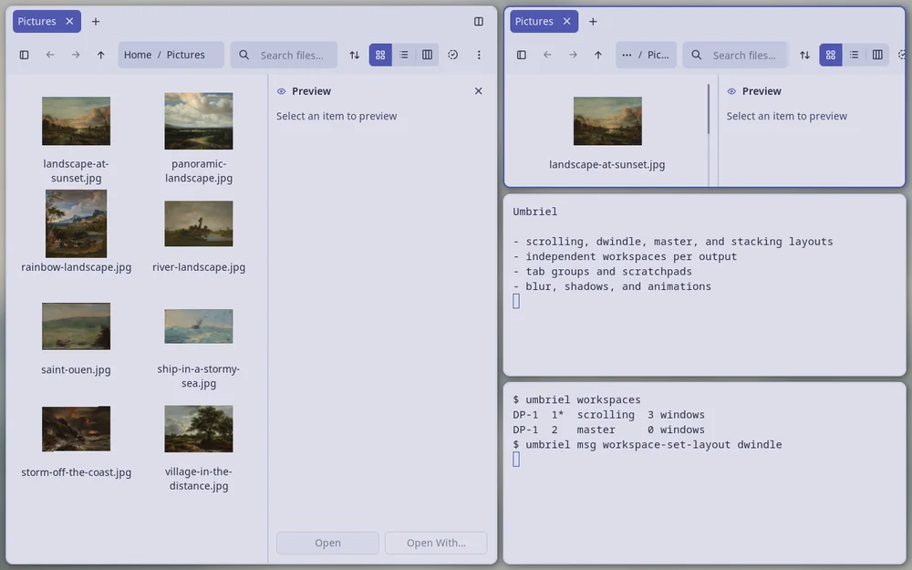

# Master layout



Master places one or more primary windows in a master area and the remaining windows in a stack. The master area may sit left, right, or between two stacks.

## Settings

```toml
[layout.master]
position = "left"
default_width_fraction = 0.55
new_on_top = true
new_becomes_master = false
```

| Key                      | Default  | Description                              |
| ------------------------ | -------- | ---------------------------------------- |
| `position`               | `"left"` | Use `"left"`, `"right"`, or `"center"`.  |
| `default_width_fraction` | `0.55`   | Initial master-area fraction.            |
| `new_on_top`             | `true`   | Put new stack windows at the top.        |
| `new_becomes_master`     | `false`  | Give the master slot to each new window. |

## Behavior

The first window becomes master. Later windows join the stack unless `new_becomes_master` is enabled. Use `layout-master-count-increase` and `layout-master-count-decrease` to move windows between the two areas.

In center mode, stack windows are balanced between the left and right sides. Primary extent actions resize the master area. Secondary extent actions resize rows within an area.

Settings shared by every layout, such as `gap` and struts, are in [Layout](layout.md#settings-for-every-layout).
