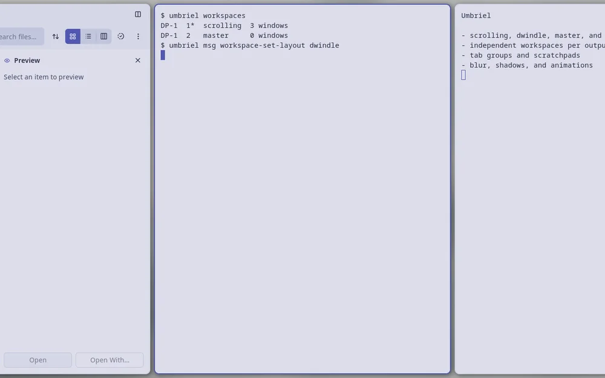

# Scrolling layout



Scrolling keeps columns at their configured extents and moves the strip through the output. A column can contain several stacked windows.

The strip is perpendicular to the output's [workspace axis](workspaces.md#workspace-axis). Vertical workspaces use a horizontal strip; horizontal workspaces use a vertical strip.

## Settings

```toml
[layout.scrolling]
default_extent_fraction = 0.5
center_underfull_strip = true
center_focused = "never"
center_on_overview_select = false
```

| Key                         | Default   | Description                                                                                                                                                   |
| --------------------------- | --------- | ------------------------------------------------------------------------------------------------------------------------------------------------------------- |
| `default_extent_fraction`   | unset     | Initial column extent from 0.1 to 4.0 (above 1.0 spans several viewports; see [Wide columns](window-states.md#wide-columns)). The packaged config uses `0.5`. |
| `center_underfull_strip`    | `true`    | Center a strip narrower than the viewport.                                                                                                                    |
| `center_focused`            | `"never"` | Use `"never"`, `"always"`, or `"on_overflow"` to control focus centering.                                                                                     |
| `center_on_overview_select` | `false`   | Center the column picked in the overview on close, like `column-center`, whatever `center_focused` says.                                                      |

## Horizontal and vertical scrolling

| Workspace axis | Scrolling arrangement                                   |
| -------------- | ------------------------------------------------------- |
| `vertical`     | Columns run left to right; windows stack top to bottom. |
| `horizontal`   | Lanes run top to bottom; windows sit left to right.     |

Primary extent actions resize a column along the strip. Secondary extent actions resize a window within its column.

A three-finger swipe along the workspace axis switches workspaces. A swipe across it scrolls the strip. Touchpad direction follows `input.touchpad.natural_scroll`.

## Scrolling behavior

When `default_extent_fraction` is unset, applications choose their initial extent. A `default_scrolling_extent` window rule overrides the fraction, and `default_scrolling_extent_px` takes highest precedence.

Set an output-specific default with:

```toml
[output.DP-1.layout.scrolling]
default_extent_fraction = 0.4
```

A workspace rule can override both global and output defaults. Reloading these settings affects new columns only.

When focus moves to a hidden column, Umbriel scrolls just far enough to reveal it. Dragged windows show an insertion preview and can be dropped into a new or existing column.

During an application drag-and-drop operation, holding the pointer near either edge of the scrolling axis reveals offscreen columns after a short delay. The strip moves faster as the pointer approaches the edge, and stops when the pointer moves away or the drag ends. A window revealed beneath a stationary pointer becomes the active drop target, so the file or other payload can be dropped without extra pointer motion.

Rearranging a tiled window by dragging it (Mod+left-click or its tab) pans the strip the same way, reaching columns beyond the current scroll extent. The trigger zone, delay, and speed are set in [Drag edge scroll](pointer-and-focus.md#drag-edge-scroll).

With `center_focused = "on_overflow"`, a column is centered when it and the neighbor focus came from cannot share the viewport, and a width change that makes them fit puts the pair back side by side at the edge focus came from. Closing the focused column or sending it to another workspace runs the same rule with the column that took its place. Moving or resizing the focused column does too, as does going fullscreen or maximized to edges. A lone column has no such pair, so it never centers itself; `center_underfull_strip` decides where it rests.

Closing a focused column moves focus to the nearest surviving column. When that column contains stacked windows, Umbriel restores its most recently focused member instead of always selecting its first row.

With `follows_mouse` set to `"sloppy"` or `"always"`, closing a focused window beneath the pointer instead focuses the tiled window that occupies that position after the layout reflows. This also applies when another row in the same scrolling column expands into the stationary pointer.

## Vertical strips

With horizontal workspaces, screen directions remain literal:

- Left and right actions move within a lane.
- Up and down actions move between lanes.
- Strip scroll actions toward up or left move toward strip start.

Configurations using vertical strips usually bind wheel navigation to `window-focus-up` and `window-focus-down` instead of the default left and right actions.

Settings shared by every layout, such as `gap` and struts, are in [Layout](layout.md#settings-for-every-layout).
