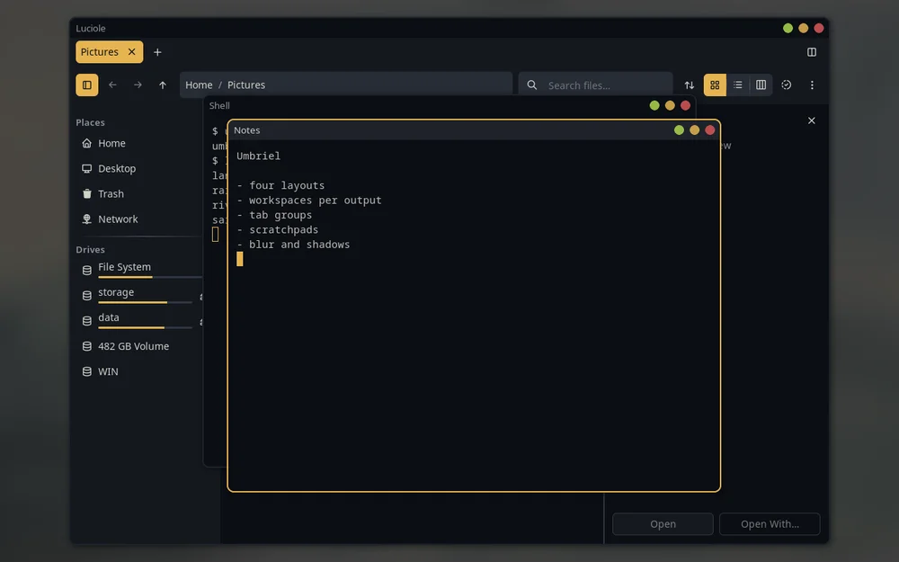

# Stacking layout



Stacking lets windows overlap at their own size and position, the way a traditional desktop does. Pair it with title bars so windows can be moved and closed without a keybind:

```toml
[layout]
mode = "stacking"

[appearance.title_bar]
mode = "on"
```

Every ordinary window opens floating at its preferred size. Oversized automatic windows are reduced proportionally to fit the usable area, including title bars and margins. Client-driven size changes keep automatic placement centered until you move the window. New windows start at the center and shift diagonally when they would completely cover another window whose upper-left corner is visible. Placement includes title bars and borders. The offset clears the decorated title bar, with a minimum of 32 logical pixels, and wraps to fresh diagonals at the output boundary, including when several windows open simultaneously. Dialogs center over their parent; explicit position rules take precedence.

Enable title bars to move windows without a modifier and use their close and maximize buttons. Dragging updates the window position continuously, so maximize and restore use its current position even while the pointer is held. Region placement animations start where you release the window and keep the normal restore box from before the drag. The configured `appearance.drag_opacity` still applies.

Directional focus uses window geometry, including overlapping windows. `window-toggle-floating` is rejected in this layout. Switching to a tiling layout re-tiles windows floated by the layout, while windows explicitly floated by a rule or before entering this layout stay floating. Moving a layout-floated window to a tiling workspace also tiles it there.

## Drop zones and region placement

```toml
[layout.stacking]
drop_zones = true
```

Drop zones are enabled by default in the stacking layout. Drag an ordinary eligible window by its title bar, a client-side move control, or Mod+drag to preview a half-screen placement on any edge or a quarter-screen placement in any corner. Targets respect panels, layout struts, gaps, borders, title bars, and client size limits in logical coordinates. Both windows floated by the layout and explicitly floating windows inside stacking can use them.

Set `drop_zones = false` to keep free dragging without edge previews or placement. This leaves existing region placements and the explicit `window-set-region` and `window-clear-region` actions available. Override it per workspace with `layout.stacking.drop_zones` in a `[[workspace]]` rule.

`window-set-region <region>` selects a half or quarter. Repeating the selected region leaves it in place; changing regions preserves the original normal box. `window-clear-region` restores that box, and clearing an unplaced window does nothing. A maximized window can be returned to its retained region with `window-set-region`. Fullscreen windows reject new region placement. Maximize and fullscreen round trips within stacking preserve the placement.

Individual floating windows above scrolling, dwindle, and master cannot use drop zones or create region placements. Leaving stacking clears region metadata. A window floated by the layout returns to tiling, while an explicitly floating window keeps its current geometry and stays floating. Maximize and fullscreen state remain intact. Returning to stacking does not revive an old region.

Settings shared by every layout, such as `gap` and struts, are in [Layout](layout.md#settings-for-every-layout).
