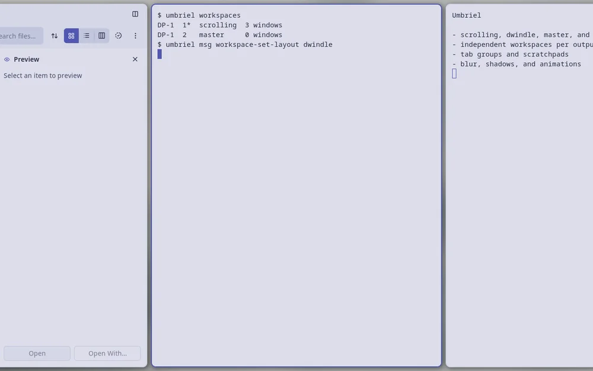
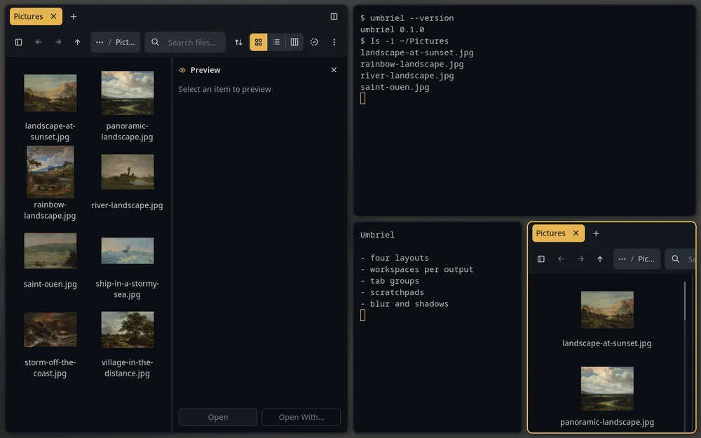
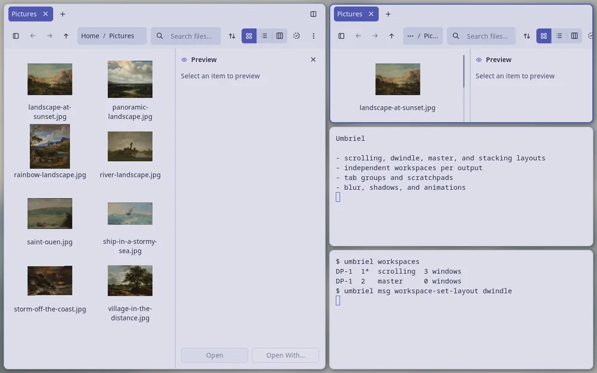
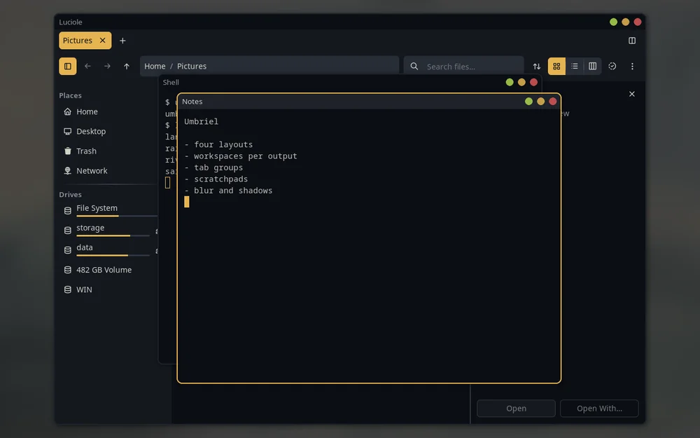

# Layout

A layout decides how windows share a workspace. Umbriel has four; each workspace uses one, and most people pick one and keep it.

## The four layouts

### Scrolling



Windows open as columns in a strip that scrolls through the output, so each keeps a readable width however many are open. A column can hold several stacked windows. This is the default. See [Scrolling layout](layout-scrolling.md).

### Dwindle



Each new window splits the focused tile in two, filling the output with ever smaller tiles. See [Dwindle layout](layout-dwindle.md).

### Master



One or more main windows sit in a master area, and the rest share a stack beside it. See [Master layout](layout-master.md).

### Stacking



Windows float at their own size and position and may overlap, moved and resized freely, with optional title bars and edge snapping. See [Stacking layout](layout-stacking.md).

## Choose a layout

Set the default for every workspace:

```toml
[layout]
mode = "scrolling"  # "scrolling", "dwindle", "master", or "stacking"
```

Set a different default for every workspace on one output, including dynamic workspaces:

```toml
[output.DP-1.layout]
mode = "master"
```

See [Outputs](outputs.md#layout-mode). Change the current workspace at runtime with `workspace-set-layout <mode>`. See [Actions](actions.md#argument-forms) and [Workspace Rules](workspaces.md#workspace-rules).

## Settings for every layout

```toml
[layout]
gap = 8
extent_presets = [0.333, 0.5, 0.667]
new_exits_fullscreen = []  # "tiled", "floating", "pinned", "all", or an array such as ["tiled", "floating"]
client_maximize = "column"  # or "edges"
```

| Key                    | Default               | Description                                                                                                                                                                                                                                                                                                         |
| ---------------------- | --------------------- | ------------------------------------------------------------------------------------------------------------------------------------------------------------------------------------------------------------------------------------------------------------------------------------------------------------------- |
| `gap`                  | `8`                   | Gap between windows in logical pixels.                                                                                                                                                                                                                                                                              |
| `extent_presets`       | `[0.333, 0.5, 0.667]` | Fractions used by primary and secondary extent cycle actions, in any order; cycling steps by size. Values run `0.1` to `4.0`; above `1.0` they apply only to scrolling columns (see [Wide columns](window-states.md#wide-columns)).                                                                                 |
| `new_exits_fullscreen` | `[]`                  | Kinds of arriving window that make a fullscreen window on the workspace leave fullscreen. See [Leaving fullscreen](#leaving-fullscreen).                                                                                                                                                                            |
| `client_maximize`      | `"column"`            | What a tiled or stacking window's own maximize button does: `"column"` uses normal layout maximize like `window-toggle-maximize`, `"edges"` fills the usable area without struts, gaps, or borders like `window-toggle-maximize-to-edges`. See [Maximize and fullscreen](window-states.md#maximize-and-fullscreen). |

### Leaving fullscreen

`new_exits_fullscreen` selects which kinds of window make a fullscreen window leave fullscreen when they arrive on its workspace. A window arrives when it opens there, is moved there from another workspace or output, is dropped there by drag-and-drop, or returns there from a scratchpad.

| Value        | Arriving window                                 |
| ------------ | ----------------------------------------------- |
| `"tiled"`    | A tiled window in the Dwindle or Master layout. |
| `"floating"` | A floating window that is not pinned.           |
| `"pinned"`   | A pinned window.                                |
| `"all"`      | Any window.                                     |

A string selects one kind and an array selects several. The empty array, the default, disables the behavior. In the scrolling layout a tiled window opens as a column beside the fullscreen one and the strip scrolls to it, so it never exits fullscreen.

### Struts

```toml
[layout.struts]
left = 0
right = 0
top = 0
bottom = 0
```

Positive struts reserve extra space inside layer-shell exclusive zones. Negative values let tiled windows extend beneath panels or beyond an output edge. Floating windows and popups ignore struts.

All layouts support `Mod+Right-drag` resizing. Drag from an edge to resize one axis or from a corner to resize both.

## Tab groups

Windows in a scrolling column or a master area can be grouped into tabs. See [Tab groups](tab-groups.md).

## Sizing and window states

How extent actions resize each layout, wide columns, floating windows, dialogs, minimize, maximize, and fullscreen are described in [Window sizing and states](window-states.md).
