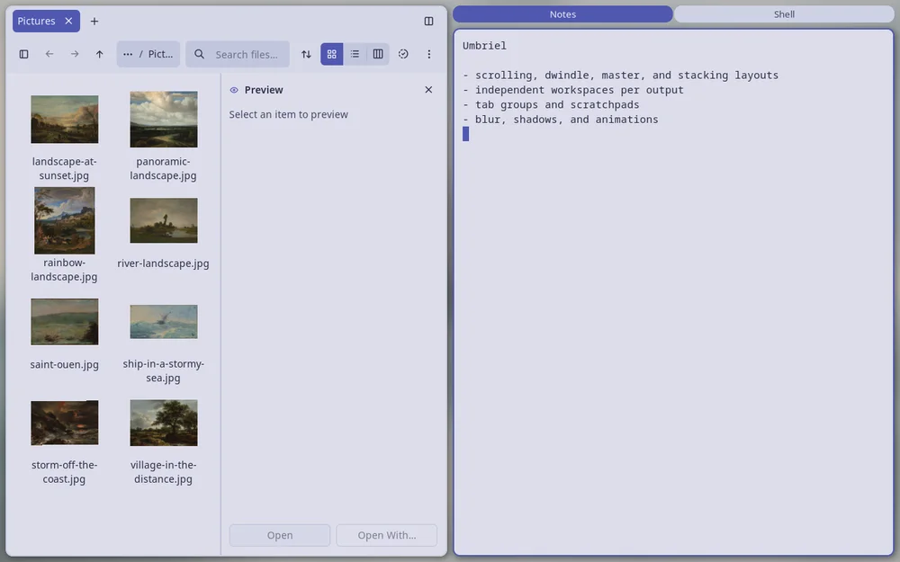

# Tab groups



A tab group gives each of its windows the same box and shows one of them, the active tab. A bar along one edge of the group has a slot for every window, and the active tab's slot is highlighted. In the scrolling layout a group is one row of its column: it stacks above and below other windows, takes a row's share of the column, and resizes like any row. A column can hold several groups, and a group can hold every window of its column. In the master layout the master area and each stack are tabbed as a whole. Dwindle tiles hold one window each, so they cannot be tabbed.

`column-toggle-tabbed` (built in as `Mod+W`; bind it under `[keybinds]` when your config lists its own) tabs the focused window together with the windows stacked next to it, up to the nearest group above and below; in a column with no groups that is the whole column. On a tab it stacks its group's windows again. `column-set-display <normal|tabbed>` does either one. The focused window becomes the active tab.

| To                                  | Do                                                                                                                                                                                                                                                                                                   |
| ----------------------------------- | ---------------------------------------------------------------------------------------------------------------------------------------------------------------------------------------------------------------------------------------------------------------------------------------------------- |
| Switch tabs                         | Click a slot, scroll over the bar, use `column-focus-tab-next` and `column-focus-tab-previous`, or jump with `column-focus-tab <index>`                                                                                                                                                              |
| Add a tab                           | Move a window into the group with `window-move-up` or `window-move-down`, consume it into a column whose last row is a group, pull the neighboring column's window in with `window-consume-from-left` or `window-consume-from-right` while a tab is focused, or drop it on the group's bar or middle |
| Put a window above or below a group | Move a tab out with `window-move-up` or `window-move-down`, or drop a window near the group's top or bottom edge                                                                                                                                                                                     |
| Remove a tab                        | Move it out, drag its slot out of the bar, expel it, float it, or move it away                                                                                                                                                                                                                       |
| Reorder tabs                        | Use `column-move-tab-next` and `column-move-tab-previous`, or drop a window between two slots                                                                                                                                                                                                        |
| Move a group                        | Mod+drag the group, in the scrolling layout, or drag its card in the overview                                                                                                                                                                                                                        |
| Resize a group                      | Drag the edge between it and the window beside it, or use the secondary extent actions on any of its tabs                                                                                                                                                                                            |
| Hide or show its bar                | Use `column-toggle-tab-bar`, `column-hide-tab-bar`, or `column-show-tab-bar`                                                                                                                                                                                                                         |
| Close a tab                         | Middle-click its slot, when `middle_click_closes` is on                                                                                                                                                                                                                                              |

In the scrolling layout `window-move-up` and `window-move-down` treat a group as one row. A tab steps out of its group toward the move and keeps the group's height. A window standing alone steps into a group it meets, as its nearest tab. A group of one tab moves past its neighbour like a window. Focus moves within a column step over a group and land on its active tab. In a tabbed master area they step through its tabs instead.

Focusing a window by any means shows its tab: a keybind, a click, activation, or IPC. Moving focus into a group from outside it lands on the active tab. Hidden tabs stay mapped and sized to the group, so switching tabs is instant and never resizes a window. A hidden tab is told it is suspended, so an application that honours it, such as recent GTK and Chromium-based ones, stops drawing until its tab shows again; it still receives frame callbacks at the rate of windows on hidden workspaces, for those that do not. A hidden tab that asks for attention lights its slot with the urgent color.

A group whose bar is hidden still works: its tabs take the bar's space, and the tab actions and focus moves still switch between them. Hiding the bar of one group leaves the others alone. `visible` under [`[appearance.tab_bar]`](#tab-bar) hides every bar a group has not shown itself.

Dropping a window onto a bar inserts it between the two slots under the pointer. Dropping it on the middle half of a group adds it where new tabs go; near the group's top or bottom it lands beside the group instead. A master area that empties starts over with `default_display` when a window next arrives.

```toml
[layout.tabs]
default_display = "normal"
new_tab_position = "end"
wrap_focus = true
scroll_switches_tabs = true
middle_click_closes = false
```

| Key                    | Default    | Description                                                                                                        |
| ---------------------- | ---------- | ------------------------------------------------------------------------------------------------------------------ |
| `default_display`      | `"normal"` | How new columns and master areas show their windows: `"normal"`, or `"tabbed"` to start each as a tab group.       |
| `new_tab_position`     | `"end"`    | Where a consumed, pulled, or dropped window joins a tab group: `"end"`, or `"after_active"` beside the active tab. |
| `wrap_focus`           | `true`     | Wrap `column-focus-tab-next` and `column-focus-tab-previous` at the ends.                                          |
| `scroll_switches_tabs` | `true`     | Step through tabs with the wheel over the bar.                                                                     |
| `middle_click_closes`  | `false`    | Close a tab with a middle click on its slot.                                                                       |

A `[[workspace]]` entry's `layout.tabs` table overrides these keys for that workspace. A window rule's `default_column_display` sets the display of the column a window opens in.

## Tab bar

The bar runs along one edge of the group, with a slot for each tab. Its `‹` and `›` buttons become `▴` and `▾` on a side bar.

```toml
[appearance.tab_bar]
style = "titles"
position = "top"
height = 24
font = "sans 10"
padding = 8
tab_gap = 2
gap = -1
corner_radius = -1
title_format = "{title}"
title_align = "center"
visible = true
hide_when_single = false
max_tabs = 0
overflow = "scroll"
```

| Key                | Default     | Description                                                                                                                                                                                                                                                                     |
| ------------------ | ----------- | ------------------------------------------------------------------------------------------------------------------------------------------------------------------------------------------------------------------------------------------------------------------------------- |
| `style`            | `"titles"`  | `"titles"` shows each tab's title in its slot. `"indicator"` draws the slots alone; pair it with a small `height` for a thin strip.                                                                                                                                             |
| `position`         | `"top"`     | The group edge the bar sits on: `"top"`, `"bottom"`, `"left"`, or `"right"`. On the top or bottom the slots sit side by side; on the left or right they stack, a vertical tab list whose titles still read across.                                                              |
| `height`           | `24`        | Thickness in logical pixels, from 2 to 400: the bar's height on the top or bottom, its width on the left or right. The group reserves the bar and its `gap` beside it. Give a side bar with titles room for them, such as `160`.                                                |
| `font`             | `"sans 10"` | Title font as a Pango description, such as `"Inter Bold 9"`.                                                                                                                                                                                                                    |
| `padding`          | `8`         | Space a title keeps from either end of its slot.                                                                                                                                                                                                                                |
| `tab_gap`          | `2`         | Space between neighbouring slots.                                                                                                                                                                                                                                               |
| `gap`              | `-1`        | Space between the bar and its window, from 0 to 500; `-1` follows the [layout `gap`](layout.md#settings-for-every-layout).                                                                                                                                                      |
| `corner_radius`    | `-1`        | Slot corner radius; `-1` follows `corner_radius`.                                                                                                                                                                                                                               |
| `title_format`     | `"{title}"` | Slot label. `{title}`, `{app_id}`, and `{index}` (from 1) are replaced; a window without a title shows its app id.                                                                                                                                                              |
| `title_align`      | `"center"`  | `"left"`, `"center"`, or `"right"` within the slot.                                                                                                                                                                                                                             |
| `visible`          | `true`      | Draw bars. `false` hides the bar of every group that has not shown its own with `column-show-tab-bar` or `column-toggle-tab-bar`; the tabs take its space and keep working from the keyboard. Those actions hide or show one group's bar whatever this says.                    |
| `hide_when_single` | `false`     | Draw no bar, and reserve no space, while a tab group holds one window. It stays a group, so the next window to join becomes a tab.                                                                                                                                              |
| `max_tabs`         | `0`         | Slots the bar shows at once, from 0 to 64; `0` shows every tab.                                                                                                                                                                                                                 |
| `overflow`         | `"scroll"`  | What a bar does with more tabs than `max_tabs`. `"scroll"` keeps the slots at their size and shows a run of tabs that follows the active one, with a `‹` and a `›` button at the ends that select the previous and next tab. `"shrink"` narrows the slots until every tab fits. |

The bar is hidden while its window is fullscreen or maximized to the edges. Titles are drawn at the output's scale and cached, so switching tabs never renders them again. A scrolled bar draws and renders titles only for the tabs it shows, however many the group holds. Clicking `‹` or `›` cycles through every tab, wrapping from the last to the first and back, and the strip follows. The wheel over the bar, the tab actions, and focus move the active tab too, and the strip follows it one slot at a time.

### Tab bar colors

```toml
[colors.tab_bar]
background = "#1A1A1FFF"
text = "#8A8A92FF"
active = "#7AA3FFFF"
active_text = "#141419FF"
active_unfocused = "#292933FF"
active_unfocused_text = "#E8E8EAFF"
urgent = "#FF6B6BFF"
urgent_text = "#141419FF"
```

| Key                     | Description                                       |
| ----------------------- | ------------------------------------------------- |
| `background`            | Slots of tabs that are neither active nor urgent. |
| `text`                  | Their titles.                                     |
| `active`                | The active tab's slot in the focused column.      |
| `active_text`           | Its title.                                        |
| `active_unfocused`      | The active tab's slot in any other column.        |
| `active_unfocused_text` | Its title.                                        |
| `urgent`                | The slot of a hidden tab that asks for attention. |
| `urgent_text`           | Its title.                                        |
